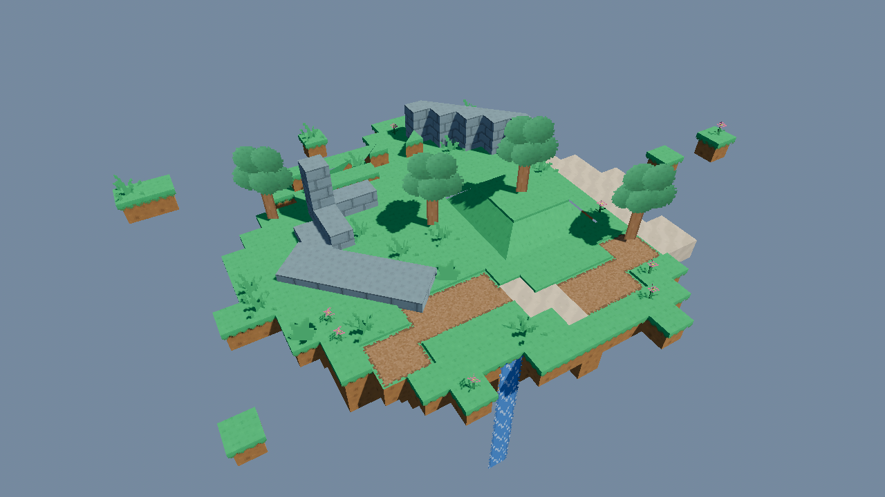

# BlockMap

A Godot 4 addon for building 3D block maps that are textured from an ordinary 2D tilesheet. Paint blocks in the 3D viewport, and each face picks its tile from your atlas.



## Features

- Block shapes: cube, slab, ramp, outer and inner corner ramps, wedge, plus sprite shapes (cross, billboard, panel, floor). See the addon README for the full table.
- Faces touching another block are never built, so maps stay light.
- Edge lip and hanging fringe on the exposed top edges of decorated blocks, or your own modeled edge and corner meshes.
- Autotile through Godot's own terrain matching (same results as a 2D TileMapLayer), using a normal TileSet.
- Animated sprites and animated top tiles, played in the shader.
- Turned grids: a child BlockMap rotated in 22.5 degree steps for diagonal layouts.
- Collision generated per chunk at runtime.
- One mesh per 16x16x16 chunk, so off-screen chunks can be skipped and edits rebuild only nearby chunks.
- Viewport painting tools with per-stroke undo and redo.

## Requirements

Godot 4.7 (tested on 4.7.2).

## Install

1. Copy `addons/block_map` into your project's `addons` folder.
2. Open Project > Project Settings > Plugins and enable BlockMap.

Keep the folder name `addons/block_map` (shaders include files by that path).

## Quick start

1. Create a BlockSet resource. Set `atlas` to your tilesheet and `tile_size` to the size of one tile.
2. Add BlockTypes to the set. For each one choose a `shape` and the atlas coordinates for `top`, `side` and `bottom`.
3. Add a BlockMap node to your scene and assign the BlockSet.
4. Select the BlockMap and paint in the 3D viewport.

Painting controls, block options, autotile setup and turned grids are covered in [addons/block_map/README.md](addons/block_map/README.md).

## Demo and tests

Open the project in Godot and run it to see the demo island (`demo/demo.tscn`). The demo atlas and scene are generated by `tools/make_atlas.gd` and `tools/make_demo.gd`.

Demo controls: drag to orbit, mouse wheel to zoom, WASD or arrow keys to pan, Q/E down/up.

Run the tests headless, after importing once:

```
godot --headless --path . --import
godot --headless --path . --script tests/test_demo.gd
godot --headless --path . --script tests/test_autotile.gd
```

## Credits

Demo textures come from the "Voxel Pack" by Kenney, https://kenney.nl/assets/voxel-pack, released under CC0. Its license is in `demo/kenney/License.txt`.

## License

MIT. See `LICENSE`.
